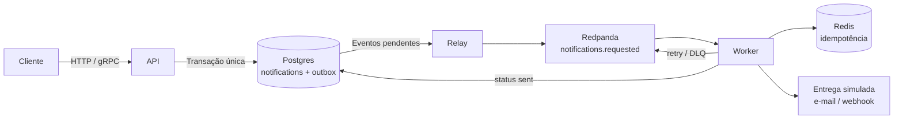

# notification-service

Serviço de notificações orientado a eventos, desenvolvido em Go. O projeto
evoluirá para receber solicitações por uma API, publicá-las por meio do padrão
outbox e processá-las de forma assíncrona com Redpanda, Redis e workers.

## Status atual

Atualmente, apenas a API inicial está implementada:

- `GET /healthz` retorna `200` e `{"status":"ok"}`;
- os testes do roteador usam `net/http/httptest`;
- Postgres, Redpanda, Redis e Redpanda Console podem ser iniciados pelo Docker
  Compose;
- a API ainda não utiliza Postgres, Redpanda ou Redis.

## Arquitetura-alvo



Essa é a arquitetura planejada. No estado atual, somente `API` e a rota
`/healthz` estão implementadas; `Relay`, `Worker`, persistência de
notificações, entregas e os fluxos de retry ainda fazem parte do roadmap.

## Pré-requisitos

- Docker com Docker Compose;
- Go 1.25 ou superior;
- GNU Make;
- `curl` para verificar a API.

## Como executar

Suba a infraestrutura local:

```bash
make up
```

Em outro terminal, inicie a API:

```bash
make run-api
```

A API ficará disponível em `http://localhost:8080`.

Verifique o health check:

```bash
curl -i localhost:8080/healthz
```

A resposta esperada inclui status `200` e o corpo:

```json
{"status":"ok"}
```

Para parar os containers:

```bash
make down
```

## Como testar

Execute os testes com detector de condições de corrida:

```bash
make test
```

## Roadmap

### Step 0 – Foundation

- [x] Docker Compose com Postgres, Redpanda, Redis e Console
- [x] Makefile e configuração local
- [x] `cmd/api` com `/healthz`
- [x] Testes de `/healthz`
- [x] Leitura inicial e documentação do projeto
- [ ] CI no GitHub Actions: vet, test, lint e build

### Step 1 – Domain and database

- [ ] `internal/domain`: entidades, validação e eventos
- [ ] Migração inicial (`notifications`, `outbox`)
- [ ] `internal/storage/postgres`
- [ ] Teste de integração com Testcontainers

### Step 2 – API

- [ ] Casos de uso de criação e consulta
- [ ] Endpoints REST de notificações
- [ ] Configuração e encerramento gracioso da API

### Step 3 – Relay and worker (MVP)

- [ ] Producer Kafka e `cmd/relay`
- [ ] Consumer, idempotência em Redis e e-mail simulado
- [ ] Status `sent` visível na consulta

### Step 4 – Reliability

- [ ] Retry com backoff exponencial e jitter
- [ ] Entrega por webhook com `Idempotency-Key` e timeout
- [ ] Testes de integração dos cenários de falha
- [ ] `make replay-dlq`

### Step 5 – Observability

- [ ] OpenTelemetry
- [ ] Métricas Prometheus e dashboard Grafana

### Step 6 – Scale and load

- [ ] Rate limiting por cliente
- [ ] Teste de carga com k6

### Step 7 – gRPC

- [ ] Contratos `.proto`, buf e código gerado
- [ ] Servidor gRPC e grpc-gateway

### Step 8 – Kubernetes

- [ ] Dockerfiles multi-stage
- [ ] Chart Helm
- [ ] Cluster local com kind e HPA para workers
